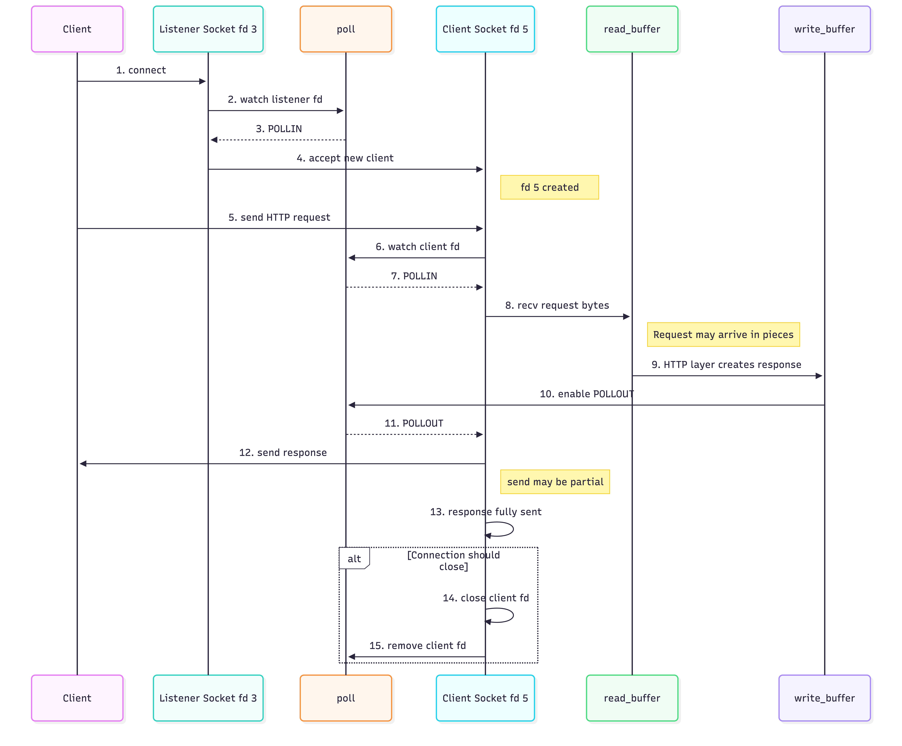
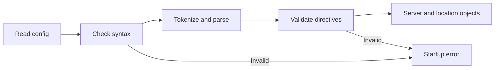
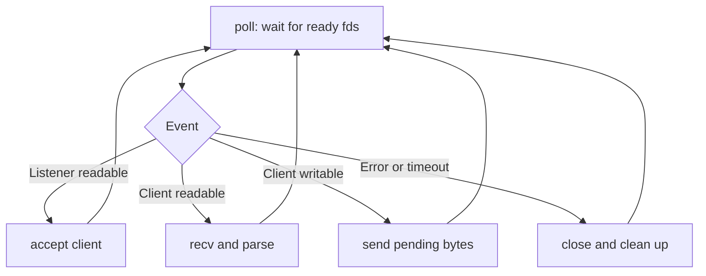

*This project has been created as part of the 42 curriculum by atammur, damohame, earutiun.*

# Webserv

## Description

A configurable, non-blocking HTTP server built from scratch in **C++98**, inspired by NGINX.

HTTP (Hypertext Transfer Protocol) is the foundation of communication on the World Wide Web. It enables clients, such as web browsers, to request resources from a server and receive responses containing web pages, files, or error messages.

**Webserv** implements this client-server communication using a single `poll()`-based event loop, allowing multiple connections to be handled efficiently without blocking.

The server supports **GET, POST, and DELETE requests**, static file serving, file uploads, configurable routing, HTTP error handling, and NGINX-inspired configuration files.

The project explores **network programming, HTTP protocol implementation, non-blocking I/O, request parsing, and connection management**, without relying on external HTTP server libraries.


Webserv demonstrates how a web server accepts TCP connections, parses HTTP requests, selects a route, and sends responses. It uses **one `poll()` event loop** to handle multiple clients without allowing a slow connection to block everyone else.


## Instructions

**Requirements:** A C++98 compiler, `make`, and POSIX networking support (Linux or macOS).

### Build and run

```bash
make                                # Build ./webserv
./webserv  <file_name.conf>         # Start with a configuration file
curl -i http://127.0.0.1:8080/      # Example if listening on port 8080
```

Run the server from a directory where relative paths in its configuration resolve correctly. Stop it with `Ctrl-C`.

```bash
make re          # Full rebuild
make clean       # Remove object files
make fclean      # Remove objects and executable
```

### Test in a browser

1. Build and start Webserv with a configuration that serves your `www/` directory:

   ```bash
   make
   ./webserv <file_name.conf> 
   ```

2. Open **http://127.0.0.1:8080/** in Chrome, Firefox, or Safari (use the host and port from your `listen` directive). If `location /` uses `root www;` and `index index.html;`, this should display `www/index.html`, provided the paths resolve from the directory where Webserv was started.
3. Open **http://127.0.0.1:8080/index.html** to test direct static-file access. Try **http://127.0.0.1:8080/not-found.html** to check your 404 response.
4. Open the browser's **Developer Tools → Network** tab, reload the page, and inspect the request method, status code, response headers, and body. Try opening a second tab while the first request is active to check that the server remains responsive.

## Architecture



1. **Client connects** to the server.
2. **`poll()` watches the listener socket**.
3. Listener gets **`POLLIN`** → a new client is waiting.
4. Server calls **`accept()`** → creates a new client socket, e.g. `fd 5`.
5. Client **sends the HTTP request**.
6. `poll()` watches the client socket.
7. Client socket gets **`POLLIN`** → request data is available.
8. Server calls **`recv()`** → bytes are added to `read_buffer`.
9. HTTP layer processes the request and creates the response in `write_buffer`.
10. Because `write_buffer` has data, server enables **`POLLOUT`**.
11. `poll()` reports **`POLLOUT`** → socket is ready for writing.
12. Server calls **`send()`** → sends response to the client. It may take multiple sends.
13. When the response is fully sent, disable `POLLOUT`.
14. If the connection should close → **close client fd**.
15. Remove the client fd/state so `poll()` no longer watches it.


### Configuration parsing



Configuration uses nested `server` and `location` blocks, semicolon-terminated directives, and `#` comments. Validation checks directive scope, listener addresses/ports, and configured values before the server starts. Supported listener forms include `listen 8080;` and `listen 127.0.0.1:8080;` (ports **1–65535**).

### Non-blocking event loop



## HTTP and routing

- **Request parsing:** HTTP/1.0 and HTTP/1.1 request lines, headers, query strings, and framed bodies.
- **Methods:** GET, POST, and DELETE are the project targets; handler support depends on the merged branch.
- **Responses:** Status line, headers, and optional body, including errors such as 400, 404, 405, 413, and 431.
- **Routing:** Longest matching configured location, with path-segment boundary checks in the project's router.
- **Allowed methods:** Locations without an explicit `methods` directive default to GET only (project policy).
- **Limits:** A location's `client_max_body_size` overrides the inherited server limit; header limits protect request parsing.

## CGI

CGI lets external programs generate dynamic responses. Webserv must pass request data and environment variables to a CGI process, read its output, and deliver a valid HTTP response **without blocking the main event loop**.

## important concepts 

### 1. What are the basics of an HTTP server, and how does it work?

An HTTP server receives requests from clients (such as browsers), processes them, and sends back HTTP responses.

**Basic flow:**

1. The server creates a socket, binds it to an IP address and port, and starts listening.
2. A client connects through TCP.
3. The client sends an HTTP request.
4. The server parses the request and finds the requested resource.
5. The server sends an HTTP response containing a status code, headers, and optionally a body.

We implement this using sockets, an HTTP parser, a router, and response handling.

---

### 2. Which event mechanism do we use? Why?

We use **`poll()`** to monitor multiple file descriptors and determine which ones are ready for reading or writing.

Instead of creating a separate thread for each client, we use a single event loop.

### Comparison

| Feature | `select()` | `poll()` | `epoll()` | `kqueue()` |
|---|---|---|---|---|
| Platform | POSIX | POSIX | Linux | macOS/BSD |
| FD limit | `FD_SETSIZE` | No fixed API limit | No fixed API limit | No fixed API limit |
| Performance | O(n) scan | O(n) scan | Efficient for large numbers of connections | Efficient for large numbers of connections |
| Complexity | Simple | Simple | More complex | More complex |
| Cross-platform | Yes | Yes | No | No |

### Why `poll()`

- Works on both Linux and macOS.
- Supports multiple clients through one event loop.
- Monitors both read and write readiness.
- Simpler than `epoll()` or `kqueue()`.
- Suitable for our project's scale.

We chose `poll()` because it is simple, portable, and allows us to handle multiple connections without blocking the server.

---

### 3. How does `poll()` work?

`poll()` monitors file descriptors and reports which ones are ready for I/O.

Each descriptor uses a `pollfd` structure:

```cpp
struct pollfd {
    int fd;
    short events;
    short revents;
};
```

- `fd`: File descriptor.
- `events`: Events we want to monitor.
- `revents`: Events that actually occurred.

### Important events

| Event | Meaning |
|---|---|
| `POLLIN` | Ready for reading |
| `POLLOUT` | Ready for writing |
| `POLLERR` | Error occurred |
| `POLLHUP` | Connection hangup |
| `POLLNVAL` | Invalid file descriptor |

`poll()` tells us which sockets are ready so we can perform I/O without blocking other clients.

---

### 4. Do we use only one `poll()`, and is it inside the main event loop?

Our Webserv architecture uses a single `poll()` call inside the main event loop.

The loop:

1. Prepares the file descriptors.
2. Calls `poll()`.
3. Processes ready descriptors.
4. Checks connection timeouts.
5. Repeats.

We use one `poll()` inside the main loop to monitor listening sockets and clients. CGI pipes should also be included when CGI is integrated.

---

### 5. How do we handle `accept()` and client read/write operations?

Each socket has a specific responsibility.

| Socket | Event | Operation |
|---|---|---|
| Listening socket | `POLLIN` | `accept()` |
| Client socket | `POLLIN` | `recv()` |
| Client socket | `POLLOUT` | `send()` |

The listener accepts connections, while client sockets handle incoming requests and outgoing responses.

---

### 6. How does `poll()` monitor both read and write readiness?

- `POLLIN`: Monitor incoming data when reading is needed.
- `POLLOUT`: Monitor writing when response data is pending.

---

## 7. Can we trace the execution from `poll()` to the client's I/O?

Yes. The simplified execution path is:

```text
Server::start()
      |
      v
    poll()
      |
      v
handleEvents()
      |
      +---- POLLIN ---> ClientConnection::readData()
      |                         |
      |                         v
      |                       recv()
      |
      +---- POLLOUT --> ClientConnection::writeData()
                                |
                                v
                              send()
```

The exact function names should be checked against the final merged code.

`poll()` detects readiness, the server dispatches the event, and the client handler performs `recv()` or `send()`.

---

## Resources

- https://nginx.org/en/docs/events.html
- https://stackoverflow.com/questions/50344945/nginx-location-match-rule-without-matching-trailing-characters?utm_source=chatgpt.com
- https://nginx.org/
- https://nginx.org/en/docs/http/request_processing.html
- https://docs.nginx.com/nginx/admin-guide/web-server/web-server/
- https://http.dev/1.0
- https://www.rfc-editor.org/info/rfc2616/
- https://stackoverflow.com/questions/246859/http-1-0-vs-1-1
- https://www.rfc-editor.org/rfc/rfc9112.html
- https://datatracker.ietf.org/doc/html/rfc7230
- https://developer.mozilla.org/en-US/docs/Web/HTTP/Guides/Evolution_of_HTTP
- https://pubs.opengroup.org/onlinepubs/009696799/functions/poll.html
- https://medium.com/@hajorda/non-blocking-sockets-and-i-o-multiplexing-with-epoll-in-c-bd3d8e54c20a
- https://mohammadtaheri.medium.com/practical-nginx-a-beginners-step-by-step-project-guide-6f4c7540c06f
- https://www.ibm.com/docs/en/zos/3.1.0?topic=instructions-setsockopt
- https://blog.nginx.org/blog/inside-nginx-how-we-designed-for-performance-scale

### AI usage

**ChatGPT, Claude Code, and GitHub Copilot (Visual Studio Code extension)** were used in:
- Debugging: Identifying and troubleshooting errors.
- Test Creation: Developing unit, integration, and edge-case tests.
- CI/CD Testing: Troubleshooting pipeline failures and improving automated test coverage.
- Code Review: Reviewing code quality and suggesting improvements.
- Documentation: Improving the README, diagrams, and technical explanations.
- Learning: Understanding HTTP, networking, and C++98 concepts.
